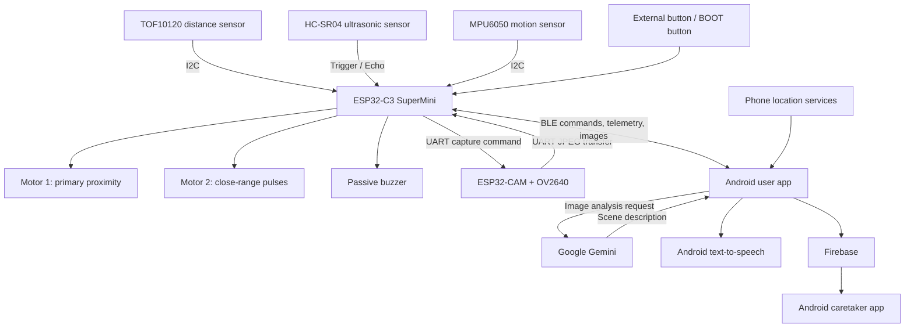

# IntelliCane

**Neural-Nexus · IoTrix 2.0 · Track A: Embedded IoT System Development**

IntelliCane is a smart white cane prototype combining local obstacle feedback, motion-based fall alerts, on-demand AI scene descriptions, and an Android companion app for users and caretakers.

An ESP32-C3 reads distance and motion sensors and controls two vibration motors and a buzzer. An ESP32-CAM captures images and transfers them through the C3 over Bluetooth Low Energy to the Android app. The phone handles Gemini scene analysis, spoken descriptions, location sharing, and Firebase connectivity.

**Team:** Dulnith Liyanage, Thenul Sahansa, Chamith Chethana, Suneth Vidurasa  
**Repository overview updated:** 15 October 2026

## Project Overview

| Subsystem | Current implementation |
|---|---|
| Obstacle sensing | TOF10120 optical ranging and HC-SR04 ultrasonic ranging; the nearest valid reading controls proximity feedback |
| Tactile feedback | Two vibration motors with different distance-dependent patterns |
| Audible feedback | Passive buzzer with a 520 Hz tone and distance-dependent cadence |
| Fall alerts | MPU6050 acceleration and tilt thresholds, with BLE fall-state messages |
| Camera | ESP32-CAM with OV2640; JPEG transfer to the C3 over UART |
| AI assistance | Android receives the image, requests a Gemini description, and speaks the response |
| Companion app | User and caretaker roles, BLE telemetry, image preview, account authentication, and location sharing |
| Caretaker monitoring | Google Maps view, online presence, location-sharing status, and fall notifications through Firebase listeners |
| Optional development tools | Camera Wi-Fi dashboard, MJPEG stream, and Python AI voice service |
| Mechanical design | STL files for the enclosure body, front lid, and clamp halves |

Local sensing and proximity feedback do not require a phone or internet connection. Live AI descriptions and remote caretaker monitoring require the relevant phone, network, and service configuration.

## System Architecture



### Main AI Vision Flow

1. The user presses the external button on C3 GPIO 3 or the onboard BOOT button on GPIO 9. Serial and BLE capture commands are also supported.
2. The C3 sends `CAPTURE` to the ESP32-CAM over UART at 115200 baud.
3. The camera returns a framed JPEG image. The default capture resolution is 320 × 240.
4. The C3 buffers the image and sends Base64 chunks over BLE.
5. The Android app reconstructs the image and displays a preview.
6. The app requests a short, navigation-focused description from Gemini.
7. Android text-to-speech reads the description aloud.

The camera configuration template disables Wi-Fi by default for this UART/BLE operating mode. The phone supplies the internet connection for Gemini.

## Obstacle Feedback

Both distance sensors contribute to a nearest-valid-distance calculation.

| Distance | Motor 1 | Motor 2 | Buzzer |
|---|---|---|---|
| 60 cm or farther | Off | Off | Silent |
| Greater than 40 cm and below 60 cm | Gentle pulses | Off | Widely spaced chirps |
| 25–40 cm | Continuous graded vibration | Off | Increasingly frequent chirps |
| Greater than 10 cm and below 25 cm | Stronger continuous vibration | Distinct pulses | Faster chirps |
| 10 cm or closer | Full commanded duty | Full-duty pulses, 160 ms on / 160 ms off | 120 ms on / 220 ms off |
| Neither sensor provides a valid distance | Off | Off | Silent |

Motor PWM runs at **200 Hz**. The current firmware selects active-HIGH motor drivers and a passive buzzer.

An invalid distance is an unknown range; silence does not establish that the path is clear.

### Fall-State Behavior

The firmware raises a fall alert when:

- Tilt reaches **65° or more**, or
- Acceleration magnitude reaches **2.5 g or more**.

It clears the alert when tilt falls below **30°**, provided the triggering condition is absent. Serial or BLE `reset` commands also clear the state, which can be raised again by subsequent sensor readings.

State changes are transmitted as:

```text
FALL_STATE:1
FALL_STATE:0
```

The normal feedback loop silences both motors and the buzzer while a fall alert is active. Button acknowledgments and manual actuator diagnostics have their own output behavior.

This is a cane motion/tilt heuristic, not confirmation that the person has fallen.

## Hardware Connections

### ESP32-C3 SuperMini

| Peripheral | C3 connection |
|---|---|
| HC-SR04 TRIG | GPIO 0 |
| HC-SR04 ECHO | GPIO 1, through suitable 3.3 V level conversion |
| TOF10120 SDA / SCL | GPIO 4 / GPIO 5; I2C address `0x52` |
| MPU6050 SDA / SCL | GPIO 4 / GPIO 5; normally `0x68`, with `0x69` also supported |
| Motor 1 driver input | GPIO 6 |
| Motor 2 driver input | GPIO 2 |
| Passive buzzer signal | GPIO 7 |
| External capture button | GPIO 3 to GND |
| Onboard BOOT capture button | GPIO 9 |
| Camera UART RX | GPIO 20, connected to ESP32-CAM TX0 / GPIO 1 |
| Camera UART TX | GPIO 21, connected to ESP32-CAM RX0 / GPIO 3 |

The sensors share a **100 kHz I2C bus**. All modules require a common ground. Use motor drivers and a suitable power supply; motors are not powered directly from GPIO pins.

### ESP32-CAM

- AI-Thinker ESP32-CAM with OV2640 camera.
- UART0 on GPIO 1 / GPIO 3 connects to the C3.
- GPIO 13 remains available as a separate active-LOW capture input.
- GPIO 4 controls the camera flash LED.
- The main C3-to-camera connection uses UART, rather than the older GPIO 21-to-GPIO 13 trigger arrangement.

See [hardware documentation](hardware/) for wiring references and power planning. Some hardware documents describe earlier builds; compare them with the active firmware before assembling hardware.

## Android Companion App

The Kotlin Android app is in [`application/`](application/).

### User Mode

- Email/password sign-up and sign-in through Firebase Authentication.
- BLE connection to the cane.
- Live telemetry terminal.
- Received-camera-image preview and transfer status.
- Automatic Gemini analysis and spoken guidance after image reception.
- Phone location sharing.
- Foreground notification with BLE disconnect and stop-sharing controls.

### Caretaker Mode

- Pairing by the user's Firebase Authentication UID.
- Online/offline presence through Firebase Realtime Database.
- Shared user location and caretaker location on Google Maps.
- Active, stale, and stopped location-sharing indicators.
- Fall notifications generated from Firestore updates.

Location is obtained from the **phone**. The current implementation does not use a dedicated GPS or cellular module on the cane.

### Firebase Data Layout

| Path | Purpose |
|---|---|
| Firestore `users/{uid}` | Account role, pairing fields, fall state, and FCM token when recorded |
| Firestore `users/{uid}/location/current` | Coordinates, sharing state, update timestamp, and fall state |
| Realtime Database `status/users/{uid}` | Online/offline presence and last-change timestamp |

The repository includes an FCM receiver. Server-side push-sending code and automated SMS delivery are not included.

## Repository Structure

```text
intelligent-cane/
├── firmware/
│   ├── core-sensing/         # Active ESP32-C3 firmware
│   ├── cam-module/           # Active ESP32-CAM firmware and config template
│   ├── archived-dual-tof/    # Earlier VL53L1X/VL53L0X design
│   └── gps-tracking/         # Earlier phone-location planning notes
├── application/              # Android companion app
├── ai-voice-service/         # Optional Python vision and speech tools
├── tests/                   # Host-side C++ feedback tests
├── 3d_files/                # Enclosure and clamp STL files
├── hardware/                # Wiring, BOM, circuit image, purchase planning
├── docs/                    # Proposals, demo guide, architecture, test records
├── ONE_PAGE_TECHNICAL_PROPOSAL.md
└── README.md
```

## Getting Started

### 1. Build the Firmware

Both active firmware folders contain PlatformIO configurations.

Create the camera's local configuration:

```sh
cp firmware/cam-module/config.h.example firmware/cam-module/config.h
```

For the main phone-assisted workflow, keep:

```cpp
#define ENABLE_WIFI false
```

A Gemini key on the camera is not required for UART image transfer. Configure the key in the Android app for phone-side analysis.

Build from the repository root:

```sh
pio run -d firmware/core-sensing
pio run -d firmware/cam-module
```

Upload each firmware to its corresponding board:

```sh
pio run -d firmware/core-sensing -t upload --upload-port <C3_PORT>
pio run -d firmware/cam-module -t upload --upload-port <CAM_PORT>
```

Both serial interfaces use **115200 baud**. Select the appropriate upload port and programming mode for each board.

The PlatformIO configurations declare the Adafruit MPU6050 dependencies for the C3 and ArduinoJson for the camera.

### 2. Configure the Android App

Open `application/` in Android Studio.

The checked-in build configuration specifies:

- Minimum Android SDK: **24**
- Compile and target SDK: **37**
- Android Gradle Plugin: **9.4.1**
- Gradle wrapper: **9.6.0**
- Gradle daemon JVM toolchain: **25**

Configure the Firebase project for package `com.example.intellicane`, including:

- Email/password authentication.
- Cloud Firestore.
- Realtime Database.
- The matching `application/app/google-services.json`.
- Database access rules permitting the intended user/caretaker relationship.

Firebase security rules and backend deployment configuration are not included in this repository.

Add the following entries to `application/local.properties`, preserving any existing Android SDK path:

```properties
GEMINI_API_KEY=YOUR_GEMINI_API_KEY
MAPS_API_KEY=YOUR_GOOGLE_MAPS_API_KEY
```

The Android Gemini service currently selects `gemini-3.1-flash-lite`.

Build the debug APK:

```sh
cd application
./gradlew assembleDebug
```

Install the app on a BLE-capable Android device and grant the requested Bluetooth, location, and notification permissions.

The current app connects directly to BLE address `48:F6:EE:17:C1:78`. The C3 firmware configures its base MAC to match that address. A different device-address setup requires corresponding configuration changes.

### 3. Use the Main Workflow

1. Power the C3, camera, sensors, and actuator modules.
2. Sign in to the Android app and select **User** mode.
3. Connect to the cane through the Bluetooth control.
4. Trigger a capture using the physical button or a Serial/BLE command.
5. View the received image and listen to the generated description.
6. Enable location sharing when required.
7. On a second phone, sign in as a caretaker and pair using the user's Firebase UID.

The pairing dialog stores `pairedUserUid` on the caretaker profile. Access to the paired user's data also depends on the deployed Firebase rules and any required user-side `caretakerUid` assignment.

## Commands and BLE Interface

The C3 advertises as **`Intelligent-Cane`** using Nordic UART Service:

| Characteristic | UUID |
|---|---|
| Service | `6E400001-B5A3-F393-E0A9-E50E24DCCA9E` |
| TX: cane to phone | `6E400003-B5A3-F393-E0A9-E50E24DCCA9E` |
| RX: phone to cane | `6E400002-B5A3-F393-E0A9-E50E24DCCA9E` |

### C3 Commands

| Action | USB Serial | BLE |
|---|---|---|
| Capture image | `c`, `capture`, `describe` | `capture`, `describe`, `CMD:CAPTURE` |
| Clear fall state | `reset` or `r` | `reset` or `r` |
| Test motors | `motor` or `m` | `motor` or `m` |
| Test buzzer | `buzz` or `b` | — |

Normal telemetry is scheduled every **250 ms**, subject to other firmware work.

Image transfer uses newline-delimited messages:

```text
IMG:START:<total_bytes>:<total_chunks>
IMG:CHUNK:<chunk_index>:<base64_payload>
IMG:END
IMG:ERROR:<reason>
```

The C3 image buffer holds up to **40,960 bytes**.

## Optional Camera Wi-Fi Mode

Set `ENABLE_WIFI` to `true` in the camera configuration and supply Wi-Fi credentials to enable the standalone web features.

| Endpoint | Purpose |
|---|---|
| `http://<camera-ip>/` | Camera dashboard |
| `http://<camera-ip>/capture` | JPEG snapshot |
| `http://<camera-ip>/describe` | Scene-description request |
| `http://<camera-ip>/status` | Camera status |
| `http://<camera-ip>:81/stream` | MJPEG stream |

The dashboard also exposes flash and resolution controls. If station connection fails, the firmware starts the configured fallback access point.

Direct camera-side Gemini analysis requires a configured camera API key and internet connectivity. Without a key, its description path returns a labeled bench simulation.

Although `AI_SERVICE_URL` appears in the configuration template, the current camera sketch does not use it to forward analysis requests.

## Optional Python AI Voice Service

[`ai-voice-service/`](ai-voice-service/) provides a separate FastAPI server and CLI for development and demonstrations. It is not required by the Android UART/BLE workflow.

```sh
cd ai-voice-service
python3 -m venv .venv
source .venv/bin/activate
python -m pip install -r requirements.txt
python -m pip install python-multipart
python -m ai_voice_service.cli serve --host 127.0.0.1 --port 8000
```

`python-multipart` is required by the image-upload endpoint but is not currently listed in `requirements.txt`.

Available endpoints include:

- `GET /` — demonstration dashboard.
- `GET /health` — service status.
- `POST /analyze/image` — multipart image upload using the `file` field.
- `GET /analyze/cane` — fetch and analyze a camera snapshot.
- `GET /audio/{filename}` — generated speech audio.

The service reads `GEMINI_API_KEY` from the environment. Its analyzer currently defaults to `gemini-1.5-flash`, independently of the Android and camera settings.

Without an API key, analysis returns a fixed `bench_simulation` response. Speech uses macOS `say` when available, with a gTTS fallback.

## Tests and Validation

### C++ Feedback Tests

From the repository root:

```sh
c++ -std=c++11 -Wall -Wextra -pedantic \
  tests/proximity_feedback_test.cpp \
  -o /tmp/intellicane-feedback-test

/tmp/intellicane-feedback-test
```

These tests cover distance boundaries, invalid readings, motor-duty progression, dual-motor zones, output polarity, pulse behavior, and the ground-hazard helper.

### Python Tests

After installing the service dependencies:

```sh
cd ai-voice-service
GEMINI_API_KEY= python -m pytest tests/
```

These tests cover result schemas, simulated analysis, and speech-file generation. Speech testing depends on the host environment.

The Android test directories currently contain starter tests rather than complete BLE, Firebase, or AI integration coverage.

A historical firmware build and host-test record is available in [the 5 October validation log](docs/test-logs/2026-10-05-software-validation.md). It applies to the revision recorded there.

## Current Limitations

- Camera transfer and several diagnostics use blocking operations. Local feedback does not depend on cloud inference, but uninterrupted sensing during capture has not been established.
- Ground-hazard classification exists as a tested helper in `ProximityFeedback.h`; the active loop currently uses both range sensors for proximity feedback.
- The Android coordinator supports sending a capture request, but the current activity does not expose a dedicated capture button.
- BLE and location handling remain tied to the Android activity. The foreground notification does not establish continued operation after activity destruction or process termination.
- Remote monitoring depends on authentication, database rules, connectivity, permissions, and the caretaker listener remaining active.
- AI descriptions and visual distance estimates are generated interpretations, not calibrated sensor measurements.
- Battery runtime, complete-system latency, physical detection accuracy, and end-to-end reliability require hardware validation.

## Design Files and Documentation

- [Enclosure and clamp STL files](3d_files/)
- [Hardware wiring](hardware/wiring.md)
- [Bill of materials](hardware/BOM.md)
- [Finals purchase and power planning](hardware/FINALS_PURCHASE_LIST.md)
- [One-page technical proposal](ONE_PAGE_TECHNICAL_PROPOSAL.md)
- [Submitted project proposal](docs/Neural-Nexus.pdf)
- [Demonstration and Q&A guide](docs/IoTrix_SemiFinal_Defense_and_Demo_Guide.md)
- [Core firmware documentation](firmware/core-sensing/README.md)
- [Camera documentation](firmware/cam-module/README.md)
- [Python service documentation](ai-voice-service/README.md)

Some supporting documents retain earlier architecture, pin assignments, cost estimates, and development plans. This README describes the current source implementation; the active source files remain the reference for exact behavior.